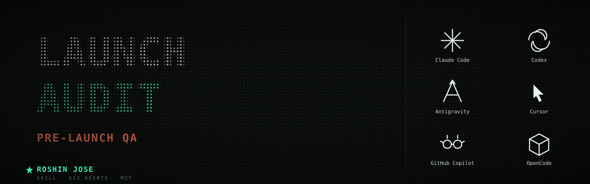

<p align="center">
  
</p>

# Launch Audit

Pre-launch website QA skill. Point it at a list of staging URLs (or a staging domain) plus the production domain, and it produces the **Launch Audit — Issue List**: a sorted `ID | Area | Check | Severity | Evidence` table covering 13 areas — SEO, indexing, performance, security, accessibility, forms, functionality/links, content/legal, AEO, redirects, analytics/consent, CMS housekeeping, email handoff — plus a **Human-confirm checklist** of everything only a human can close (test form submissions, consent decisions, CRM purges, spot-checks).

Built for HubSpot CMS staging→prod cutovers (`explore.client.com` → `client.com`) but works on any site.

Key guarantees:
- **Read-only** — never submits forms or changes CMS state; those become human-confirm items.
- **Evidence-first** — every row cites char counts, contrast ratios, byte sizes, exact URLs.
- **Staging-aware** — canonicals on the temp domain are filed as "verify at cutover", not defects.
- **Honest** — unverifiable checks show up as unverified (`—` / spot-check), never as passed.

## Usage

```
/launch-audit https://explore.suturetex.com/ https://explore.suturetex.com/services … → automation-control.com
```

or just paste the staging URL list and say "run a launch audit; production domain is automation-control.com".

## Files

| File | Purpose |
|------|---------|
| `SKILL.md` | Claude Code skill (phases, rules of engagement, area map) |
| `reference/check-catalog.md` | Full per-area check list with severity defaults and evidence formats |
| `reference/report-format.md` | Issue-table + human-confirm-checklist spec, example rows, re-audit rules |
| `reference/hubspot-launch.md` | HubSpot-specific behavior (domain flip, form GUIDs, code alerts, system pages) |
| `prompts/…` | Self-contained paste-in copies for the other five tools (shared body, different wrappers) |

## Install per tool

| Tool | How |
|------|-----|
| **Claude Code** | Symlink the folder: `ln -s ~/.agents/skills/launch-audit ~/.claude/skills/launch-audit` → invoke with `/launch-audit` |
| **OpenAI Codex** | Paste `prompts/codex-system-prompt.md` as the system prompt |
| **Google Antigravity** | Paste `prompts/antigravity-system-prompt.md` as the system prompt |
| **Cursor** | Copy `prompts/cursor-rules.mdc` to `<project>/.cursor/rules/launch-audit.mdc` |
| **GitHub Copilot** | Copy `prompts/copilot-instructions.md` to `<project>/.github/copilot-instructions.md` and commit |
| **OpenCode / Cline / Aider** | Copy `prompts/opencode-AGENTS.md` to `<project>/AGENTS.md` |

The five paste-in files are snapshots of one shared body — when `SKILL.md` or `reference/*.md` change, regenerate them.
